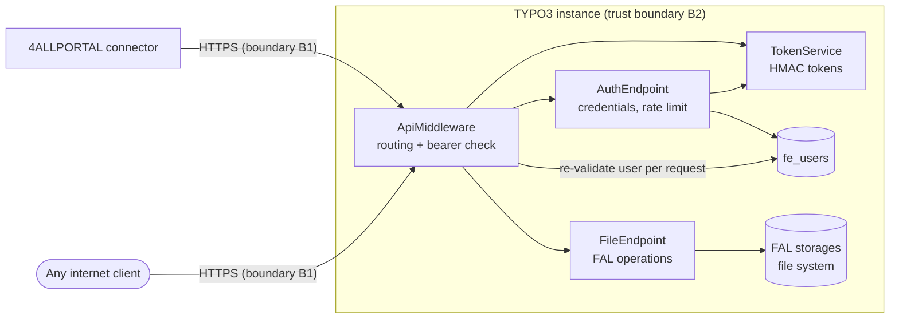

# Threat Model

This document describes what the extension protects, where its trust boundaries are, which
threats were considered and how they are countered. It serves as the security assurance case of
the project and must be reviewed whenever endpoints, authentication or deployment assumptions
change.

Method: data flow analysis
with [STRIDE](https://learn.microsoft.com/en-us/azure/security/develop/threat-modeling-tool-threats)
per trust boundary.

## Scope

In scope: the extension code in `Classes/` and `Configuration/`, its HTTP API under `/api` and
the release pipeline. Out of scope: TYPO3 core, the web server, PHP and the 4ALLPORTAL connector
itself, except for the assumptions listed below.

## Assets

| Asset                  | Why it matters                                                       |
|------------------------|----------------------------------------------------------------------|
| Files in FAL storages  | Published website media; deleting or replacing them defaces the site |
| `fe_users` credentials | Grant API access; may also be used for regular frontend logins       |
| Bearer tokens          | Grant API access for up to one hour                                  |
| TYPO3 `encryptionKey`  | Signs tokens; compromise allows token forgery (see S3)               |
| File metadata          | Rendered on the website (title, alternative text, copyright)         |
| Release artifacts      | TER archive installed by customers                                   |

## Data flow and trust boundaries

- **B1, internet to TYPO3**: every request to `/api/*` is untrusted. The middleware runs before
  TYPO3's frontend authentication, so no frontend session applies to API calls.
- **B2, extension to TYPO3 core**: file operations go exclusively through the FAL API, never
  through direct file system calls. Path and file name validation is delegated to FAL.

## Assumptions

- A1: TLS is terminated in front of TYPO3. Credentials and tokens are sent in plain text inside
  the TLS channel.
- A2: The `fe_users` account used by the connector is a dedicated service account.
- A3: The TYPO3 `encryptionKey` is secret and unique per installation.
- A4: TYPO3's `fileDenyPattern` and storage configuration are left at secure defaults.
- A5: If TYPO3 runs behind a reverse proxy, `reverseProxyIP` is configured so the real client IP
  is known.
- A6: On sites with frontend logins other than the connector account, the extension setting
  `allowedFrontendUserGroups` is set. Left empty, every active frontend user is an API user.
- A7: The `ter` environment requires a reviewer before a TER upload runs.

## Threats and mitigations

Status: **Mitigated** = countered in code, **Partial** = depends on an assumption or is
incomplete, **Open** = known gap, see [Open findings](#open-findings).

### Spoofing

| ID | Threat                                   | Mitigation                                                                                                                                                   | Status         |
|----|------------------------------------------|--------------------------------------------------------------------------------------------------------------------------------------------------------------|----------------|
| S1 | Password brute force on `/api/auth`      | Sliding-window limit of 20 attempts per IP and 5 minutes (`AuthEndpoint::createRateLimiter`)                                                                 | Partial (A5)   |
| S2 | Username enumeration via response timing | Unknown users trigger a dummy hash computation (`AuthEndpoint::verifyCredentials`); identical error response                                                 | Mitigated      |
| S3 | Forged token                             | HMAC signature with `encryptionKey` (`TokenService`); the password fingerprint additionally requires the stored password hash                                | Mitigated (A3) |
| S4 | Stolen token replayed                    | One-hour expiry; every request re-checks that the user is active, still in an allowed group and the password is unchanged (`ApiMiddleware::isAuthenticated`) | Partial        |

### Tampering

| ID | Threat                                                       | Mitigation                                                                                                                                                                      | Status         |
|----|--------------------------------------------------------------|---------------------------------------------------------------------------------------------------------------------------------------------------------------------------------|----------------|
| T1 | Path traversal via `targetPath`, `fileName` or `newFileName` | Folders are resolved segment by segment through FAL; FAL rejects `..` and `//` in identifiers                                                                                   | Mitigated      |
| T2 | Upload of executable code (e.g. `.php`)                      | FAL checks the file extension against `fileDenyPattern` on add, rename and move                                                                                                 | Mitigated (A4) |
| T3 | Writing outside configured storages                          | `storageUid < 1` is rejected, so the fallback storage rooted at the web root cannot be used (`FileEndpoint::upload`)                                                            | Mitigated      |
| T4 | Overwriting arbitrary metadata fields                        | Only `title`, `description`, `alternative`, `keywords` and `copyright` are written (`FileEndpoint::updateMetadata`)                                                             | Mitigated      |
| T5 | Stored XSS via metadata values                               | Values are stored as given; output escaping is the job of the rendering templates (Fluid escapes by default)                                                                    | Partial        |
| T6 | Tampered release archive                                     | SLSA Build L3 provenance and SBOM attestation per release; the pipeline uploads the attested archive to the TER itself, see [SECURITY.md](../../SECURITY.md#verifying-releases) | Mitigated      |
| T7 | Leaked TER token used to publish a malicious version         | Token is only available to the TER upload job via the `ter` environment; required reviewers on that environment gate every upload                                               | Partial (A7)   |

### Repudiation

| ID | Threat                                                 | Mitigation                                                                 | Status |
|----|--------------------------------------------------------|----------------------------------------------------------------------------|--------|
| R1 | File deleted or replaced without a trace of who did it | Only `fe_users.lastlogin` is updated; file operations are not audit-logged | Open   |

### Information disclosure

| ID | Threat                                                   | Mitigation                                                                                                                   | Status         |
|----|----------------------------------------------------------|------------------------------------------------------------------------------------------------------------------------------|----------------|
| I1 | Stack traces or server paths in error responses          | Exceptions are logged server-side, clients receive a generic message (`FileEndpoint::serverError`, `ApiMiddleware::process`) | Mitigated      |
| I2 | Token payload reveals the password hash                  | The payload carries only a keyed HMAC fingerprint of the hash (`TokenService::passwordFingerprint`)                          | Mitigated      |
| I3 | Reading files through the API as a regular frontend user | Only members of the allowed groups obtain and keep a token, see E1                                                           | Mitigated (A6) |

### Denial of service

| ID | Threat                                                  | Mitigation                                                                      | Status       |
|----|---------------------------------------------------------|---------------------------------------------------------------------------------|--------------|
| D1 | Locking out the connector by exhausting the login limit | Limit is per client IP; without `reverseProxyIP` all clients share the proxy IP | Partial (A5) |
| D2 | Filling the disk with large or many uploads             | Only PHP's `upload_max_filesize` / `post_max_size` and storage quotas apply     | Partial      |

### Elevation of privilege

| ID | Threat                                          | Mitigation                                                                                                                                                                                     | Status         |
|----|-------------------------------------------------|------------------------------------------------------------------------------------------------------------------------------------------------------------------------------------------------|----------------|
| E1 | Any active frontend user gains full file access | Tokens are issued to and re-validated for members of `allowedFrontendUserGroups` only (`FrontendUserGroupPolicy`); a user outside these groups gets the same response as for wrong credentials | Mitigated (A6) |

## Open findings

| ID | Risk   | Description                                                                                               | Proposed treatment                                                                 |
|----|--------|-----------------------------------------------------------------------------------------------------------|------------------------------------------------------------------------------------|
| R1 | Medium | No audit trail for destructive operations.                                                                | Log file operations with user uid, action and file identifier via the PSR-3 logger |
| D1 | Low    | Shared rate-limit bucket behind misconfigured proxies.                                                    | Document `reverseProxyIP` in the installation guide                                |
| D2 | Low    | No size limit of its own.                                                                                 | Accept; document reliance on PHP and storage limits                                |
| S4 | Low    | Tokens cannot be revoked individually before expiry, only by disabling the user or changing the password. | Accept; one-hour lifetime keeps the window small                                   |

## Maintenance

Review this document when:

- an endpoint, request parameter or response field is added or changed,
- authentication, token handling or rate limiting changes,
- a new deployment model or connector version changes the assumptions,
- a security report is received.
